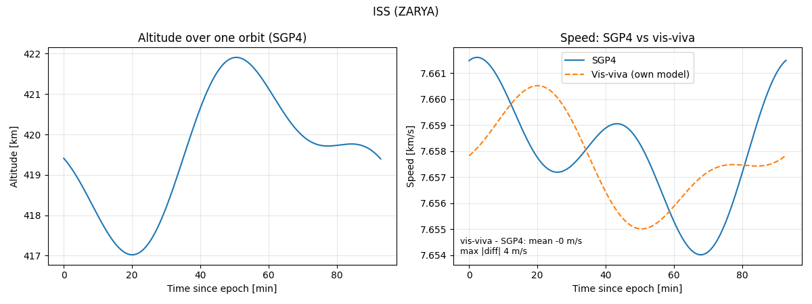
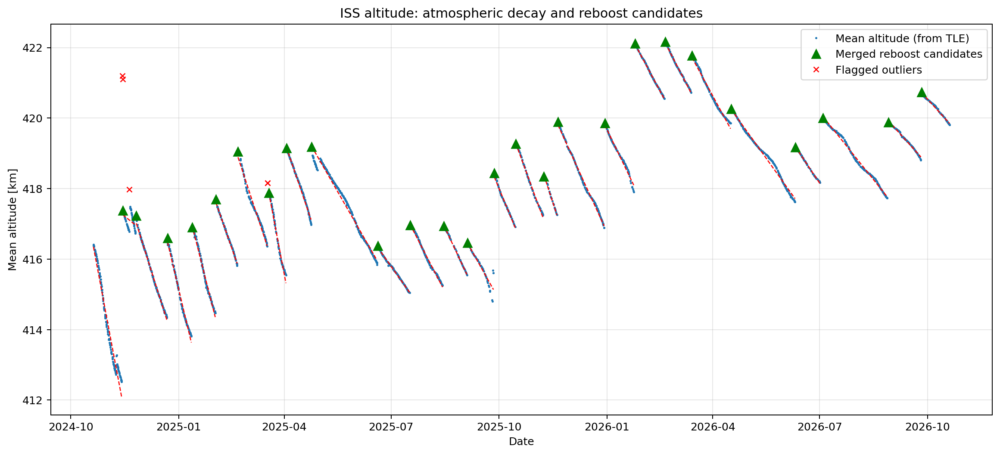
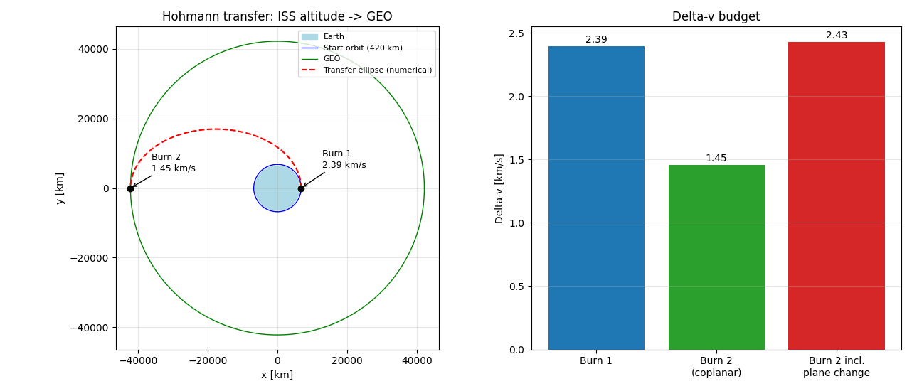

# ISS Orbit Analysis: Atmospheric Decay, Reboosts and a Hohmann Transfer

A Python project that uses public orbital data of the International Space Station (ISS) to study orbital mechanics:

1. **Orbit from a TLE**: compute orbital parameters and compare my own Keplerian model with SGP4.
2. **Orbital decay and reboosts**: analyze two years of TLE history to measure atmospheric-drag-induced altitude loss, detect reboost maneuvers, and check the detections against a hand-made list of known reboosts.
3. **Hohmann transfer**: compute the delta-v and propellant cost of a transfer from ISS altitude to geostationary orbit (GEO), including a plane change.

| Script | What it does |
|---|---|
| `iss_week1.py` | Orbital parameters from the latest TLE, SGP4 vs. vis-viva speed |
| `iss_week2.py` | Altitude time series, outlier filtering, reboost detection, decay rate |
| `compare_reboosts.py` | Matches detected reboost candidates to a reference list of known reboosts |
| `iss_hohmann.py` | LEO to GEO Hohmann transfer, plane change, rocket equation, numerical check |

**Data sources.** Part 1 uses the current ISS TLE from [CelesTrak](https://celestrak.org). Part 2 uses ISS TLE history from [Space-Track](https://www.space-track.org). The Part 2 results below come from a download on 20 October 2026 covering the preceding 730 days; because the script always requests the most recent 730 days, a later run gives a different window and slightly different numbers. Raw Space-Track data is not included in this repository.

## Part 1: Orbit from a TLE

The latest ISS TLE is downloaded from CelesTrak. The semi-major axis is derived from the mean motion, and one full orbit is propagated with SGP4. I then compute the speed along the orbit with the vis-viva equation (my own Keplerian model, using SGP4's radius and the semi-major axis from the TLE) and compare it with SGP4's speed.

Example run (values change with each new TLE):

| Quantity | Value |
|---|---|
| Orbital period | 92.97 min |
| Perigee / apogee altitude | 415.2 km / 424.4 km |
| Vis-viva vs. SGP4 speed difference | mean 0.028 %, max 0.048 % |



The remaining difference and the non-sinusoidal altitude curve are consistent with Earth-oblateness (J2) effects that SGP4 models and a pure Keplerian orbit does not. I did not separately verify this attribution.

## Part 2: Orbital decay and reboosts

**Data.** About two years (October 2024 to October 2026) of ISS TLE history (3,209 records). The mean altitude of each record is computed from its mean motion: `a = (mu / n^2)^(1/3)`, `altitude = a - R_E`.

**Method.**
1. *Outlier filter*: each point is compared with the median of its centered 7-point window. Points deviating by more than 0.5 km are excluded from the analysis, shown on the plot, and saved to `removed_points.csv`.
2. *Reboost detection*: a reboost is flagged where the median of the next 3 points is more than 0.3 km above the median of the previous 3 points. Using medians means a single bad TLE cannot trigger a detection. Each candidate is also written to `reboost_validation.csv` with its single-step gain, its local-median gain and the days since the previous candidate.
3. *Decay rate*: a straight line is fitted to the altitude between consecutive reboosts (segments with at least 5 points spanning at least 5 days). The decay rate is the median slope across segments.

**Results.**

| Result | Value |
|---|---|
| Records / flagged outliers | 3,209 / 5 |
| Reboost candidates | 26 (typically 3 to 4 weeks apart, most between +1 and +3.5 km, largest +4.85 km on 2024-11-14) |
| Median decay rate between reboosts | **-69.2 m/day (-2.08 km/month)** |
| Same, without outlier filtering | -71.0 m/day (-2.13 km/month) |

The decay rate changes by only about 2.5 % when outlier filtering is switched off, so the result is not sensitive to this preprocessing step.



**Observations.**
- Four of the five flagged records lie within about a day of a large reboost (2024-11-14 and 2025-03-18). A possible explanation is that these TLEs were fitted from tracking data spanning a maneuver. This is a hypothesis; I have not verified it.
- Three of the 26 reboost candidates have a gain of only 0.4 to 0.55 km (2024-11-25, 2025-06-19, 2026-04-16) and should be treated as low-confidence. The 2026-04-16 one is confirmed by the reference list.

### Validation against a reference list

The detector above only uses the TLE data itself, so I also checked it against an independent record. `compare_reboosts.py` reads a hand-made list of known reboost dates (`reboost_reference.csv`) and the detected candidates (`reboost_validation.csv`). Each listed burn is matched one-to-one to the closest candidate within ±3 days (closest pairs first, so a candidate is never used twice). The ±3 days allow for the fact that the TLE reflecting a burn is published some time after the burn itself. Every row is classified as:

- `MATCH`: a listed burn with a detected candidate within ±3 days
- `MISSED`: a listed burn with no candidate
- `EXTRA`: a candidate that is not in the list
- `OUT_OF_RANGE`: a listed burn outside the period covered by the data

**Reference list source:** `reboost_reference.csv` lists 9 reboosts with date (UTC), vehicle and source URL. The sources are mixed in quality: three entries cite nasa.gov pages (one of them an image caption page) and six cite news sites (Space.com, isstracker.pl, newspaceeconomy.ca), with one article cited for several dates. Only dates were recorded, not burn times, and all entries are currently marked `verified = no` (the date has not been checked against a second source). The list is incomplete by construction: it contains only publicly reported burns, and eight of its nine entries fall between September 2025 and April 2026.

**Threshold tuning:** **[TODO: state whether the detection thresholds were chosen before or after looking at this list]**

**Threshold tuning:** The detection threshold (0.3 km) was set before the reference list was compiled, by inspecting the altitude plot, and I did not change it after seeing the comparison, so the list was not used to tune the detector. A 0.5 km threshold would have missed the 0.41 km candidate that the list confirms for 2026-04-16.

| Result | Value |
|---|---|
| Listed burns inside the data period | 9 |
| MATCH / MISSED | 8 / 1 |
| EXTRA (candidates not in the list) | 18 |
| OUT_OF_RANGE | 0 |
| Recall (MATCH / listed burns inside the period) | 8 / 9 = 89 % |
| Mean delay between the burn date and the first TLE showing the new orbit | 1.20 days (range 0.84 to 1.82) |

The delay is measured from midnight UTC of the listed date, because only dates were recorded; every matched candidate came after the listed burn. The one missed burn is the Dragon reboost of 2024-11-08; the nearest candidate is about six days later (2024-11-14), so it is probably a different burn.
The full per-burn table is in `reboost_comparison.md`. An `EXTRA` candidate is only a false detection if the reference list is complete for the period; a list built from public announcements may miss real burns, so I read `EXTRA` as "not in the list", not as an error rate.

## Part 3: Hohmann transfer from ISS altitude to GEO

A coplanar Hohmann transfer between circular orbits (420 km altitude to GEO, r = 42,164 km), computed with the vis-viva equation. Because the ISS orbit is inclined by about 51.6 degrees and GEO is equatorial, I also compute the plane change, combined with the second burn at apogee via the law of cosines. Propellant fractions follow from the Tsiolkovsky rocket equation.

| Quantity | Value |
|---|---|
| Burn 1 / Burn 2 (coplanar) | 2.392 / 1.454 km/s |
| Total delta-v (coplanar) | 3.846 km/s |
| Transfer time | 5.29 h |
| Burn 2 including 51.64 deg plane change | 2.428 km/s |
| Total delta-v with plane change | 4.820 km/s |
| Propellant fraction, Isp 450 s (coplanar / with plane change) | 58.2 % / 66.5 % |
| Propellant fraction, Isp 320 s (coplanar / with plane change) | 70.6 % / 78.5 % |

A separate plane-change burn at GEO speed (about 3.07 km/s) would cost `2 v sin(delta_i / 2)`, about 2.68 km/s, so combining it with the second burn saves roughly 1.7 km/s.



**Validation.** The transfer ellipse is integrated numerically (two-body equations of motion, `scipy.integrate.solve_ivp`). After the predicted transfer time the radius and speed agree with the analytic values to within numerical precision. Note that this only checks the implementation, because both calculations use the same two-body model. As a plausibility check against the literature, the coplanar total of 3.85 km/s is close to the commonly quoted value of about 3.9 km/s for LEO to GEO.

## Limitations

- TLE mean elements are approximate; altitudes use a spherical Earth of equatorial radius, so they are mean orbital altitudes rather than true altitudes above the surface.
- The outlier and reboost thresholds (0.5 km and 0.3 km) were chosen by inspection of the data, not derived from a noise model.
- Only upward steps are searched for, so any other kind of orbit change is not examined. Reboost dates are only as precise as the TLE sampling.
- The reference list is hand-made and incomplete, so the recall and delay figures are only as reliable as that list. Publicly reported burns may also be larger than average, which would make recall look better than it would be on all burns.
- The decay rate varies from segment to segment (it depends on atmospheric density and solar activity). I report only the median and have not yet related it to solar activity data.
- The Hohmann calculation assumes impulsive burns, a two-body model (no J2, no third-body effects), and a start from the ISS orbit as a teaching scenario. It is not a mission design.

## Possible extensions

- Relate the segment-by-segment decay rate to solar activity (for example the F10.7 index).
- Split the plane change between both burns and optimize the split to reduce the total delta-v.

## How to run

```
pip install numpy scipy matplotlib requests sgp4
python iss_week1.py
python iss_week2.py          # asks for your Space-Track login the first time, caches iss_history.json
python compare_reboosts.py   # needs reboost_reference.csv and reboost_validation.csv (written by iss_week2.py)
python iss_hohmann.py
```

Create a free account at space-track.org for Part 2. The script asks for your login in the terminal; the password is never stored in the code.
